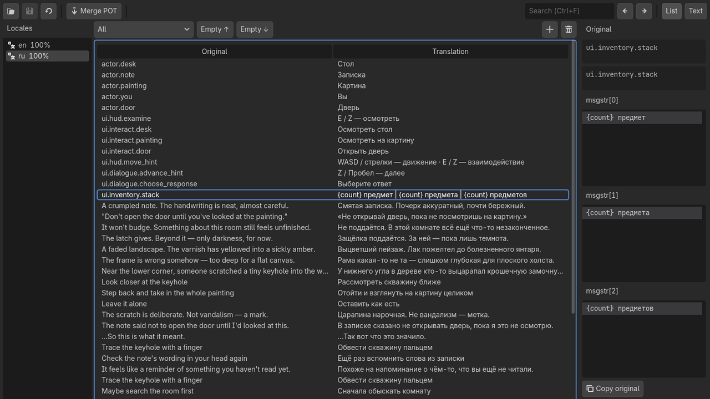

# po_notepad

A `.po` translation catalog editor for Godot 4.7: edit entries one by one or as plain text, merge the project's POT file list into the open catalog, and check placeholders and plural forms before saving. The full description is in [addons/po_notepad/README.md](addons/po_notepad/README.md) (Russian: [README.ru.md](addons/po_notepad/README.ru.md)).



License: [MIT](LICENSE).

## Installation

Copy `addons/po_notepad` into your project's `addons/` folder and enable it in Project Settings → Plugins → po_notepad.

## Repository layout

- `addons/po_notepad/` — the plugin. Only this folder goes into downloaded archives (see `.gitattributes`).
- `test/po_notepad/` — GdUnit4 tests.
- `media/` — icon and screenshots for the store pages. `.gdignore` keeps Godot from importing them.
- `project.godot` — a minimal project to open the plugin and run the tests without a game.

## Release archive

`.gitattributes` excludes everything except `addons/`, so a clean archive for the Asset Store is:

```
git archive --format=zip -o po_notepad.zip HEAD
```

The Godot Asset Library builds the same archive from the repository by itself.

## Tests

GdUnit4 is not part of the repository. Install it into `addons/gdUnit4` (from the Asset Library or a GdUnit4 release), then:

```
godot --headless --path . --import
godot --path . --headless -s addons/gdUnit4/bin/GdUnitCmdTool.gd --ignoreHeadlessMode -c -a res://test
```
